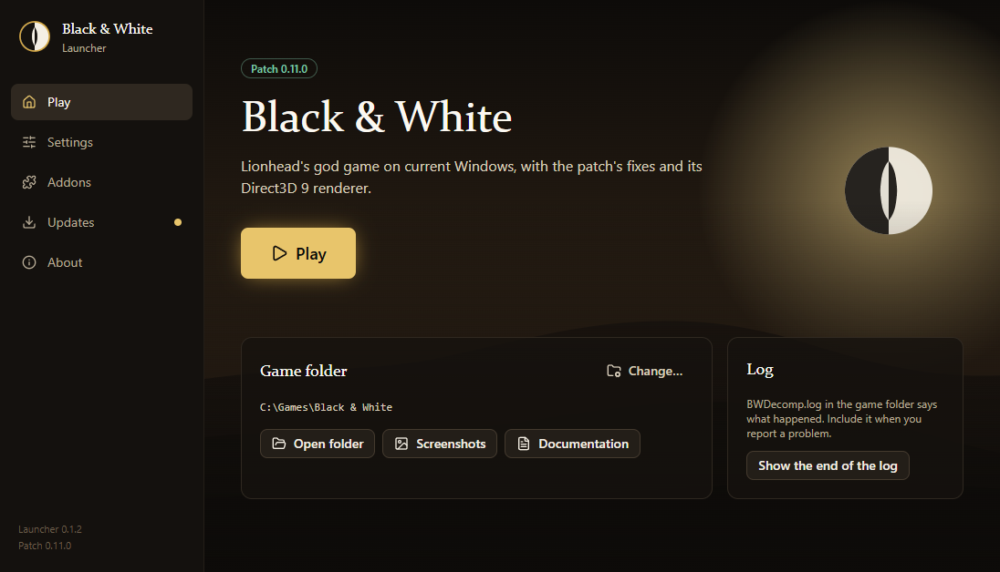
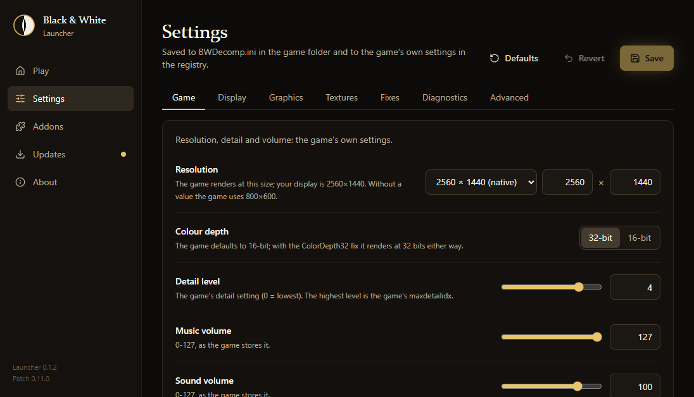
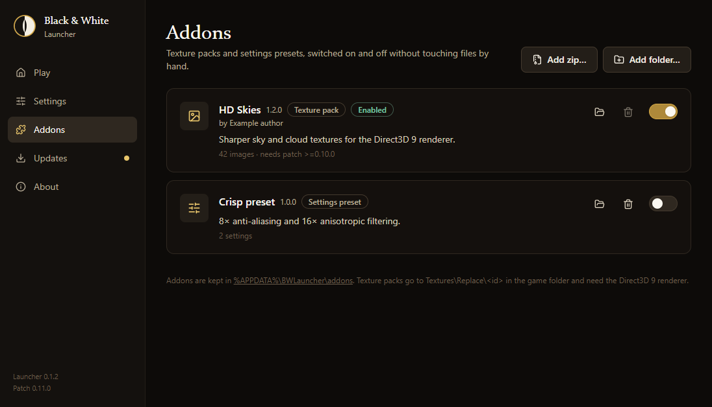

<p align="center">
  
</p>

<h1 align="center">Black &amp; White Launcher</h1>

<p align="center">
  Play Lionhead's <em>Black &amp; White</em> (2001) on current Windows: one download that installs the community
  patch into your copy of the game, lets you tune it, and starts it.
</p>

<p align="center">
  
</p>

## Why

*Black & White* still has a devoted audience, but the game no longer runs well on Windows 10 and 11. Its copy
protection (SafeDisc) needs a driver Windows removed, it rejects modern DirectX, crashes at high resolutions, hangs
when quitting, and wants the disc in the drive.

The **Black & White patch** fixes these problems while the game runs. It changes none of the game's own files.
`BWLaunch.exe` starts the original `runblack.exe` and loads `BWDecomp.dll` into it before the game's first instruction.
The DLL then sends specific functions of the game to corrected versions. Everything else is still Lionhead's code, so
the game plays as it always did, only now it works.

This launcher packages the patch in a friendly desktop app. You don't need to copy files by hand, edit INI files or
the registry, or know any of the above.

## What the patch gives you

- **Starts on Windows 10 and 11** without SafeDisc, the DirectX version check or the disc in the drive.
- **A Direct3D 9 renderer** with native and widescreen resolutions, anti-aliasing, anisotropic filtering and vertical
  sync.
- **Windowed and borderless modes**, with scaling that keeps the picture's shape.
- **Fixes for crashes and hangs**: the high-resolution and 16-bit Direct3D crashes, video and audio memory limits,
  DPI scaling, Data Execution Prevention, CPU detection, and the hang on quitting.
- **Texture packs**: replace the game's textures with your own images, by name.

## What the launcher does

**First start: a guided setup.**
1. Finds your game folder, or lets you pick it, and checks that `runblack.exe` is the supported version. If it isn't,
   it explains what you have and what to do.
2. Installs the patch next to the game, asking for administrator rights only if the folder needs them (for example
   below Program Files).
3. Offers the essentials: resolution, window mode, vertical sync, anti-aliasing and texture filtering.

**After that, it opens on Play.**

| | |
|---|---|
| **Play** | Starts the patched game. If it fails, the launcher shows the end of its log. |
| **Settings** | Every patch option and the game's own resolution, detail and volume, explained, with hints when one setting affects another. Your comments in `BWDecomp.ini` are kept. |
| **Addons** | Texture packs and settings presets, added from a folder or zip and switched on and off with one click. Turning a preset off puts your settings back. |
| **Updates** | Checks for new launchers and new patches, which are released separately. A newer patch installs straight into your game folder without waiting for a new launcher. Every download is checked against its release's SHA-256 sums before it is used. |
| **About** | The patch's documentation, running setup again, and removing the patch. |

<p align="center">
  
  
</p>
<p align="center"><sub>Settings, and the Addons page with two sample addons.</sub></p>

## Requirements

- Windows 10 or 11 (64-bit). WebView2 is part of Windows. If it is missing, the setup program installs it.
- *Black & White* **1.00 (English)**, installed from the disc.
- The **unprotected `runblack.exe`** from the disc's `crack` folder, copied over the installed one. The `runblack.exe`
  that the game's setup installs is wrapped in SafeDisc, which current Windows cannot run. The launcher recognises it
  and tells you what to do.

The official 1.1 and 1.2 updates replace `runblack.exe` with builds the patch does not support.

## Getting started

1. Download `BWLauncher-<version>-Setup.exe` from the latest release. A portable `BWLauncher-<version>-Portable.exe`
   that needs no installing is there too.
2. Run it and follow the setup.
3. Press **Play**.

The launcher is not code-signed yet, so Windows SmartScreen may warn the first time. Choose *More info*, then *Run
anyway*. Each release lists the SHA-256 sums of its files.

Already used the older `BWDecompSetup.exe`? The launcher finds that installation and takes it over.

## Good to know

- **Nothing of the game changes.** The patch adds `BWLaunch.exe`, `BWDecomp.dll`, `BWDecomp.ini` and a `BWDecomp`
  folder with its documentation. Starting `runblack.exe` directly still runs the game as it was.
- **Something went wrong?** `BWDecomp.log` in the game folder records what happened. The Play page can show its end. Please include it when you report a problem.
- **Start without the window:** `bw-launcher.exe --play` starts the game straight away, which is handy for shortcuts.
- **Removing it:** *About → Remove the patch* takes the patch's files out of the game folder. Your changed settings,
  saved games, screenshots and texture packs stay. Then uninstall the launcher from Windows' *Settings → Apps*.
- **Your launcher data** (game folder, options, addons) lives in `%APPDATA%\BWLauncher`.

## Addons

An addon is a folder (or a zip of one) with an `addon.json` that says what it is:

- **`texture-pack`**: images in `textures\`, copied to `Textures\Replace\<id>\` in the game folder. They need the
  Direct3D 9 renderer.
- **`preset`**: a set of `BWDecomp.ini` values, applied when switched on and reverted when switched off.

See [`examples/addons`](examples/addons) for one of each. Addons can name the patch versions they need, and kinds
added in later launcher versions are listed rather than rejected.

## For developers

The launcher is a [Tauri 2](https://tauri.app) app: a Rust backend for installing, settings, elevation, launching and
updates, and a React and TypeScript interface. The patch's release files are embedded at build time from `payload\`.

```powershell
. .\scripts\env.ps1             # cargo and the MSVC tools on PATH
.\scripts\sync-payload.ps1      # the patch's build output into payload\
npm install
npm run tauri dev               # or: npm run dev, for the interface alone with sample data
.\scripts\package.ps1           # tests, then the setup program, portable exe and SHA-256 sums in dist\
```

The GitHub repositories checked for launcher and patch updates are set in [`updates.ini`](updates.ini).

[AGENTS.md](AGENTS.md) is the guide to the code: layout, how each part matches the patch's own setup program, rules,
and how to verify a change. Changes are listed in [CHANGELOG.md](CHANGELOG.md).

## Legal

This repository contains no code, data, art or other material from *Black & White*. You need your own copy of the
game. *Black & White* is a game by Lionhead Studios. This launcher and the patch are fan projects, not affiliated
with or endorsed by Lionhead Studios, Electronic Arts, Microsoft or any other rights holder. The logo and artwork in
the launcher are original.
